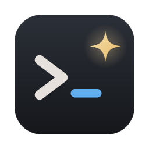

# Termina

A terminal written in [Lyra](https://github.com/Lyra-Language/lyra), after Warp: commands
and their output as blocks, and a command line you edit like text in an editor. macOS and
Linux.

**Status: early.** The login shell runs in a window, in tabs (⌘T, ⌘W, ⌘1–9). With zsh or bash (4.4 or newer), the command line is an
editor of Termina's own, in a box pinned to the window's foot: several lines, the mouse (double-click a word to select it),
word-by-word motions, undo, the clipboard, history, and Tab completion — the shell's own, in a menu. It is a classic terminal underneath: color (16, 256,
24-bit) and attributes, wide characters, full-screen programs (vim, less, top), the mouse, and
selection and copy. Termina ▸ Settings… (⌘,) chooses the font, its size and the colors. Blocks
come next (`CLAUDE.md` § Plan).

```bash
../lyra/build.sh     # the compiler, with std/ and bindings/ beside it (SDL3 needed)
./build.sh           # build/termina (and build/Termina.app on macOS), and the tests
build/termina
build/termina-ui     # the same terminal on Lyra's own GUI framework instead of Dear ImGui,
                     #   coming: tabs as buttons, no menus or Settings yet
```

Releases (`git tag vX.Y.Z` and push it) carry Termina.app for Apple silicon, signed with a
Developer ID and notarized, and for Linux on x86_64 and arm64 an AppImage (make it
executable and run it once: it adds itself to your desktop's launcher) and an archive
(unpack and run `./termina`). Each has SDL3 inside.

MIT licensed (`LICENSE`).
